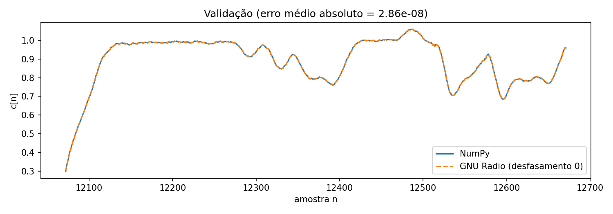
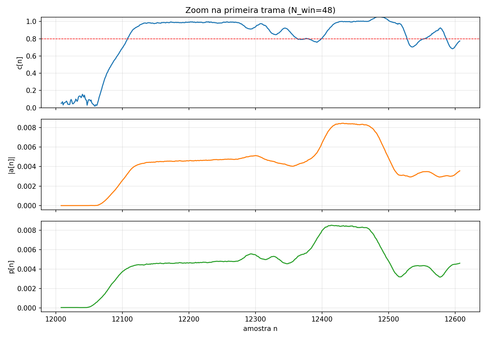
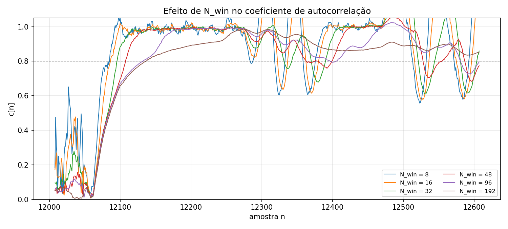
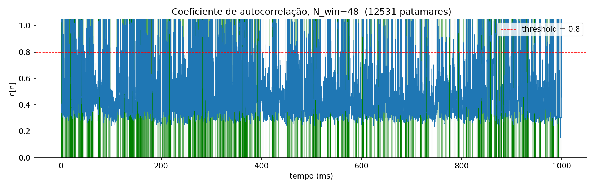

# Semana 1 — Deteção de trama: autocorrelação e potência (Secção 2.2)


## 1. Objetivos

- Rever os parâmetros do sistema OFDM 802.11a.
- Identificar no flowgraph os blocos que calculam a autocorrelação e a potência.
- Obter um gráfico equivalente à Fig. 2 do paper (coeficiente de autocorrelação `c[n]` durante a receção de uma trama).
- Explorar o efeito da janela `N_win` em `c[n]`.

## 2. Parâmetros do 802.11a (OFDM, 20 MHz)

| Parâmetro | Valor |
|---|---|
| Largura de banda do canal | 20 MHz |
| Taxa de amostragem | 20 Msps |
| Tamanho da FFT/IFFT | 64 pontos |
| Espaçamento entre subportadoras | 20 MHz / 64 = **312,5 kHz** |
| Subportadoras usadas | 52 = **48 de dados + 4 pilotos** (pilotos nos índices ±7 e ±21) |
| Subportadoras não usadas | 12 = DC (índice 0) + 11 de guarda (−32…−27 e +27…+31) |
| Duração do símbolo OFDM | 4 µs (3,2 µs úteis + 0,8 µs de prefixo cíclico) |
| Comprimento do símbolo | 80 amostras (64 úteis + 16 de prefixo cíclico) |
| Preâmbulo curto (STS) | padrão de 16 amostras repetido 10×: **160 amostras = 8 µs** |
| Preâmbulo longo (LTS) | 32 amostras de GI + 2×64 = **160 amostras = 8 µs** |
| Preâmbulo total | 320 amostras = 16 µs |

**Porque há subportadoras não usadas?** As de guarda, nas extremidades do espetro, dão margem para a transição dos filtros e reduzem a interferência para canais adjacentes. A DC não é usada porque os recetores de conversão direta têm *offset* de DC e fugas do oscilador local nessa frequência.

## 3. Blocos do flowgraph

Mapeamento entre as equações do paper e os blocos do GNU Radio (`flowgraphs/projeto.grc`):

| Equação | Blocos |
|---|---|
| Autocorrelação `a[n]` (eq. 1) | `Delay 16` → `Complex Conjugate` → `Multiply` (com o sinal sem atraso) → `Decimating FIR` com taps `[1]*window_size` (soma móvel) |
| Módulo `\|a[n]\|` | `Complex to Mag` |
| Potência `p[n]` (eq. 2) | `Complex to Mag^2` → `Decimating FIR` com taps `[1]*window_size` |
| Coeficiente `c[n]` (eq. 3) | `Divide` (`\|a[n]\|` / `p[n]`), ligado à entrada `cor` do `WiFi Sync Short` |

O atraso de 16 amostras corresponde ao período do padrão do preâmbulo curto. `window_size` = 48 (valor sugerido no paper).

**Tags (secção 2.1)** — **TODO:** confirmar no código-fonte do módulo (`sync_short` e `sync_long`) que tags são adicionadas, com que nome e valor, e em que amostra.

## 4. Alterações ao flowgraph e metodologia

1. O bloco `Throttle` estava a 200 kS/s com `samp_rate` = 20 MHz; foi corrigido para `samp_rate`.
2. Foi acrescentado um `File Sink` (float) à saída do `Divide`, a gravar `results/c_gr.bin`.
3. O modelo de `c[n]` foi reproduzido em NumPy (`scripts/plot_autocorr.py`), o que permite varrer `N_win` sem voltar a correr o GNU Radio.
4. O modelo NumPy foi validado contra a saída real do GNU Radio.

Captura usada: `Sample1_20MHz_Channel36.bin` (Moodle), 5,18 GHz. Analisado o primeiro segundo (20 M de amostras).

Para reproduzir:

```bash
python3 scripts/plot_autocorr.py \
    --samples captures/Sample1_20MHz_Channel36.bin \
    --gr-output results/c_gr.bin
```

## 5. Resultados

### 5.1 Validação do modelo NumPy



O erro médio absoluto entre o `c[n]` do NumPy e o do GNU Radio é **2,9×10⁻⁸**, com desfasamento de **0 amostras**. O modelo NumPy reproduz o flowgraph, por isso as figuras e estatísticas seguintes (incluindo o varrimento de `N_win`) são representativas do que o GNU Radio calcula.

### 5.2 Comportamento de c[n] numa trama (equivalente à Fig. 2)



Com `N_win` = 48, na primeira trama detetada:

- `|a[n]|` e `p[n]` sobem em conjunto (a partir da amostra ≈ 12 050) e `c[n]` sobe de ≈ 0,05 até ≈ 0,98. O patamar de ≈ 0,98 mantém-se entre as amostras ≈ 12 130 e ≈ 12 280.
- A subida demora cerca de 60 amostras (≈ 3 µs). Isto é coerente com o esperado: o primeiro produto `s[n]·s*[n−16]` com sinal só aparece 16 amostras depois do início da trama, e a janela de 48 amostras demora mais 48 amostras a encher.
- Depois do patamar, `c[n]` desce mas mantém-se entre ≈ 0,7 e ≈ 1,0 durante várias centenas de amostras (ver pontos em aberto na secção 6).

### 5.3 Efeito de N_win



Estatísticas sobre 1 s de captura, com threshold 0,8 e patamar = pelo menos 3 amostras consecutivas acima do threshold (`results/w1_window_stats.csv`):

| N_win | nº de patamares | largura média (amostras) | `c` médio nos patamares | `c` médio fora dos patamares | desvio-padrão fora | máximo fora |
|---:|---:|---:|---:|---:|---:|---:|
| 8 | 266 900 | 9,0 | 1,20 | 0,34 | 0,20 | 6,89 |
| 16 | 95 690 | 14,4 | 1,04 | 0,26 | 0,17 | 2,33 |
| 32 | 24 607 | 23,7 | 0,94 | 0,19 | 0,14 | 3,34 |
| 48 | 12 531 | 28,7 | 0,92 | 0,16 | 0,13 | 2,17 |
| 96 | 2 575 | 59,6 | 0,91 | 0,13 | 0,11 | 2,93 |
| 192 | 624 | 168,9 | 0,90 | 0,10 | 0,10 | 2,08 |

Observações (lidas do gráfico, valores aproximados):

- **Latência de subida.** `c[n]` cruza 0,8 mais cedo com janelas pequenas: ≈ 12 095 (N=8), ≈ 12 100 (N=16), ≈ 12 108 (N=32), ≈ 12 115 (N=48) e ≈ 12 130–12 135 (N=96 e 192). A janela maior atrasa a deteção.
- **Ruído antes da trama.** Antes do início da trama, `N_win` = 8 e 16 têm picos de ≈ 0,5–0,65, enquanto 48, 96 e 192 ficam abaixo de ≈ 0,15. Janelas pequenas são mais ruidosas.
- **Fragmentação.** Com janelas pequenas, `c[n]` oscila muito dentro e depois do preâmbulo, com quedas até ≈ 0,6 que atravessam o threshold. Uma mesma trama gera vários patamares curtos (largura média de 9 amostras para N=8).
- **Janelas grandes.** Com `N_win` = 192 (maior que as 160 amostras do STS), `c[n]` sobe muito devagar e nunca tem um patamar nítido.

### 5.4 Vista global



Esta figura satura: com 12 531 patamares em 1 s, não é possível distinguir tramas individuais. Nota: a figura usa *max-pooling* (máximo em blocos de 1 000 amostras), o que eleva visualmente o piso; o piso real é o da tabela (`c` médio fora dos patamares ≈ 0,16 para N=48).

## 6. Conclusões

1. **A deteção por autocorrelação funciona.** Com lag 16 e `N_win` = 48, `c[n]` passa de ≈ 0,05 (ruído) para ≈ 0,98 (patamar) quando começa a trama, como na Fig. 2 do paper.
2. **A escolha de `N_win` é um compromisso.** Janelas pequenas (8, 16) respondem mais cedo mas são ruidosas e fragmentam o patamar; janelas grandes (96, 192) são mais suaves mas atrasam a deteção e deixam de ter patamar nítido quando se aproximam das 160 amostras do STS. `N_win` = 48 dá um bom equilíbrio: patamar quase em 1, piso baixo (≈ 0,16) e latência ≈ 65 amostras.
3. **O número de patamares não é o número de tramas.** O número de patamares desce quase em proporção inversa a `N_win`: o mesmo sinal produz 266 900 patamares com N=8 e 624 com N=192. Por isso, parte das deteções é fragmentação do mesmo preâmbulo ou falsos positivos.
4. **`c[n]` pode ser maior que 1.** O máximo fora dos patamares chega a 2–7 e a média nos patamares é > 1 para N=8. Isto acontece porque, pela desigualdade de Cauchy–Schwarz, `|a[n]| ≤ √(p[n]·p[n−16])`, e `c[n]` é normalizado apenas por `p[n]`. Quando a energia da janela atual é menor que a da janela 16 amostras antes, o rácio pode passar de 1. **Implicação:** um threshold sobre `c[n]` não é imune a transitórios de energia. Isto liga-se à Semana 2 e à entrada `abs` do `Sync Short`.
5. **Validação.** O modelo NumPy coincide com o flowgraph (erro 2,9×10⁻⁸), o que permite explorar parâmetros fora do GNU Radio.

### Pontos em aberto (para Semanas 2 e 3)

- **Duração do patamar.** Com N=48 esperava-se que `c[n]` ficasse perto de 1 até cerca de `início + 160` (fim do STS) e decaísse nas ≈ 48 amostras seguintes. Nos dados, o patamar de ≈ 0,98 estende-se até ≈ 12 280, e `c[n]` mantém-se acima de ≈ 0,8 até ≈ 12 370–12 390, ou seja, cerca de 320 amostras depois do início da subida (≈ STS + LTS). Hipóteses a testar: (a) a captura tem filtragem que suaviza o sinal e alarga a correlação; (b) o LTS tem correlação com lag 16 maior do que se assumiu; (c) o início real da trama é outro. Para testar: plotar `|s[n]|` na trama e calcular a autocorrelação com lag 64.
- **Número de tramas.** Quantas tramas reais há no primeiro segundo? Ver com o resto da cadeia (SIGNAL e MAC) quantas são descodificadas.
- **Máximos acima de 1** (conclusão 4): confirmar a explicação medindo `p[n]/p[n−16]` nos instantes em que `c[n] > 1`.

## 7. Checklist da Semana 1 (guia)

- [x] Parâmetros do 802.11a
- [x] Blocos de autocorrelação e potência identificados
- [x] Gráfico equivalente à Fig. 2
- [x] Efeito de `N_win` explorado
- [ ] Tags da secção 2.1 (confirmar no código)

## 8. Ficheiros

- Script: `scripts/plot_autocorr.py`
- Flowgraph: `flowgraphs/projeto.grc`, `flowgraphs/projeto.py`
- Figuras e estatísticas: `results/w1_*.png`, `results/w1_window_stats.csv`
